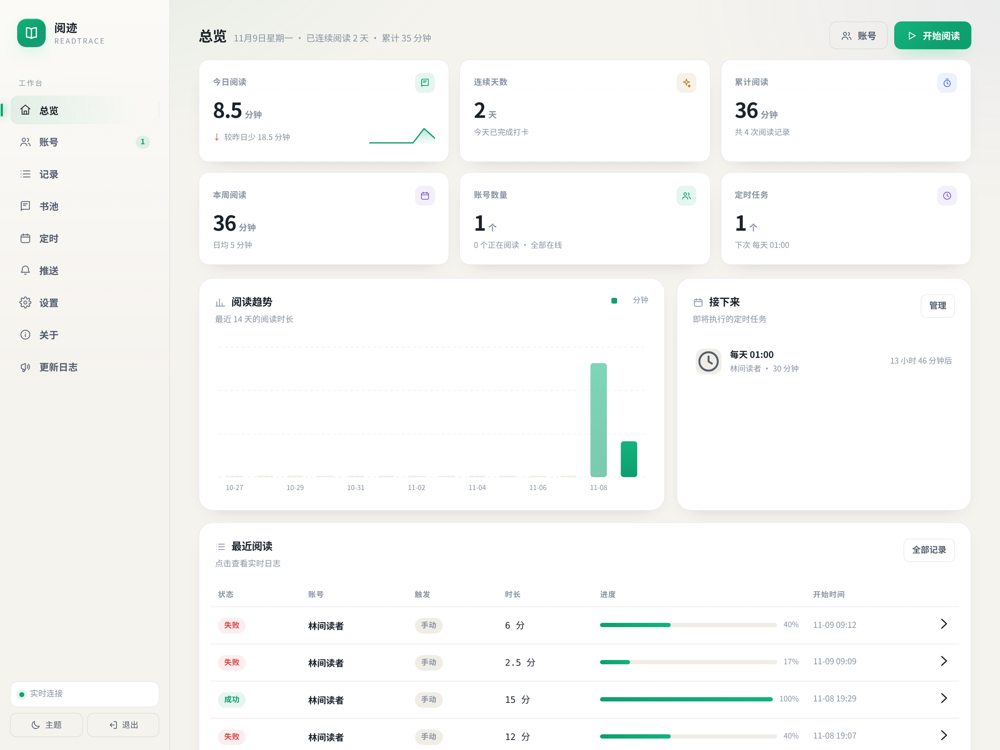
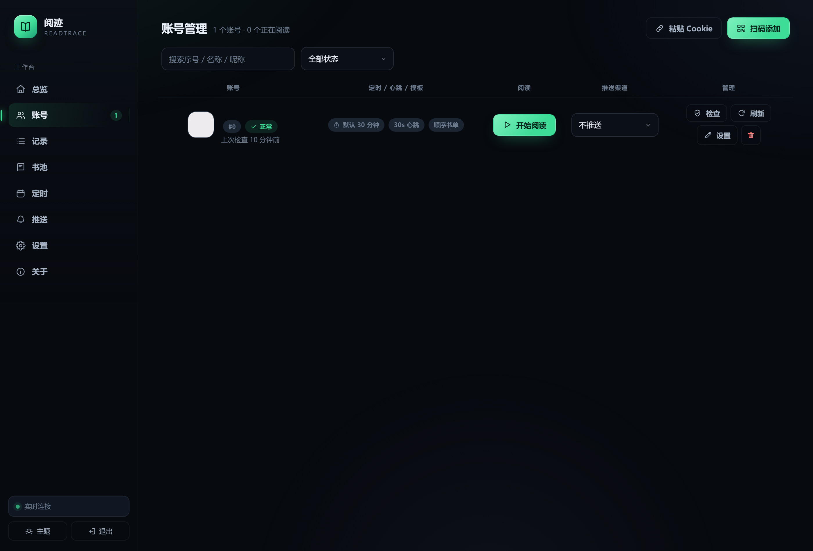
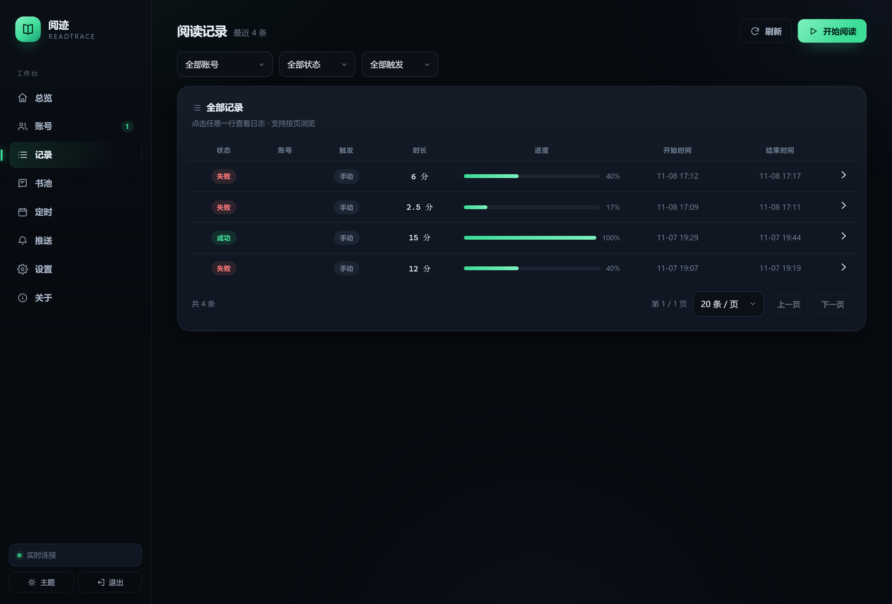
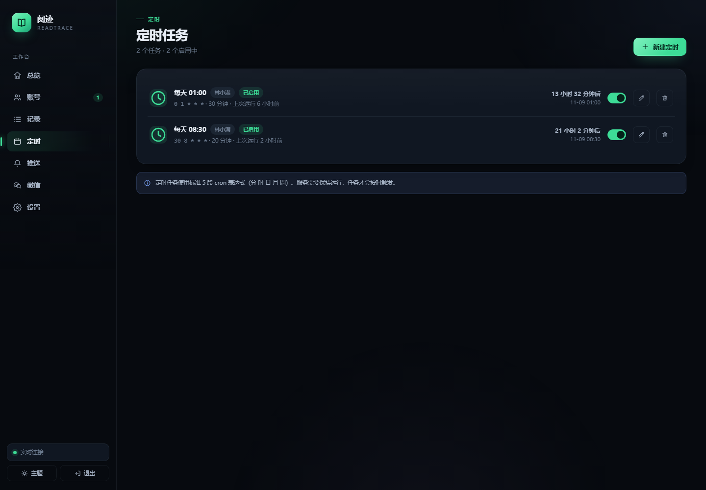
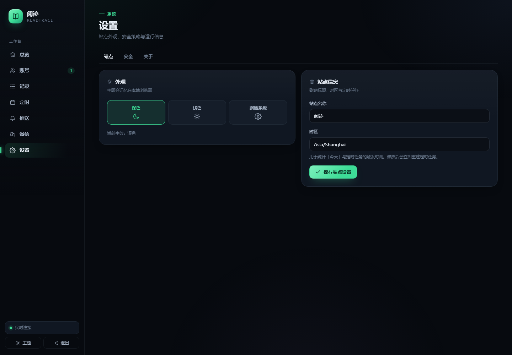
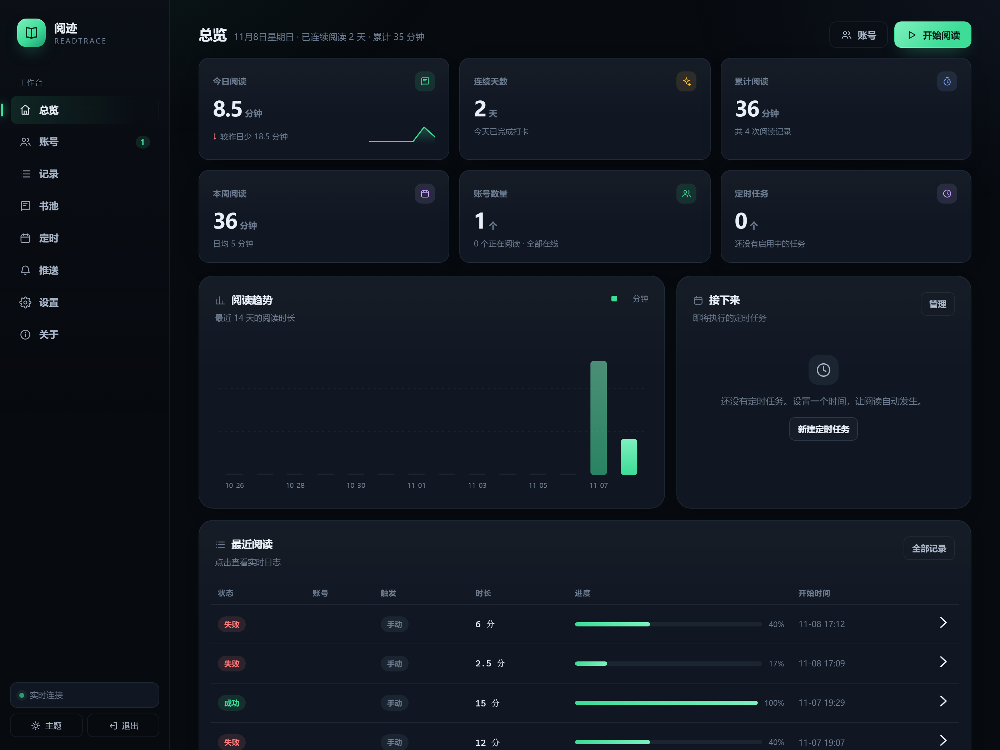
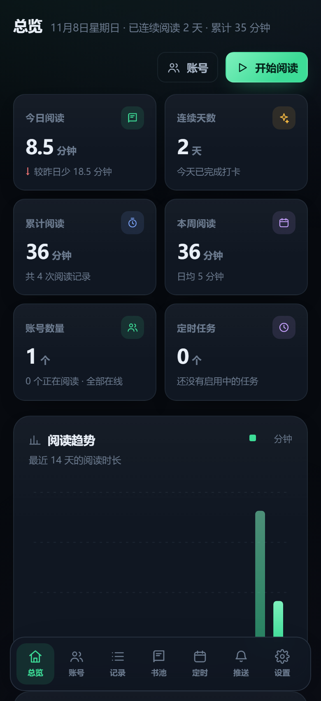

# 读时 · ReadPilot

> 一个单文件、可自托管的微信读书阅读面板。扫码登录，实时看进度，自动跑定时，把阅读时长和数据都留在自己手里。

原版 [findmover/wxread](https://github.com/findmover/wxread) 用环境变量 + 控制台日志 + 一次性定时任务完成“刷时长”，好用但看不见、管不住、不好排错。读时把它重做成一个带可视化面板的常驻服务：**Go 单二进制 + SQLite + 内嵌前端**，打开浏览器就能管理账号、看实时进度、查历史趋势、配推送与定时任务。



---

## 为什么重做

| 能力 | findmover/wxread | 读时 · ReadPilot |
| --- | --- | --- |
| 部署形态 | Python 脚本 / GitHub Action / Docker | **单个二进制**，内嵌前端，无需 Node/Python |
| 配置方式 | 环境变量 / config.py | **可视化面板**，配置存 SQLite |
| 登录方式 | 手动抓 curl | **微信扫码登录**，也支持 curl / Cookie 导入 |
| 运行状态 | 控制台日志 | **SSE 实时进度 + 日志流**，可随时停止 |
| 历史数据 | 无 | **每日时长、连续天数、累计趋势、运行记录** |
| 多账号 | 不支持 | **多账号独立配置与统计** |
| 定时任务 | 服务器 cron / Action cron | 面板内 **图形化 cron + 下次执行时间 + 启停** |
| Cookie 失效 | 再次抓包 | 自动续期，失败时标记失效并提示重扫 |
| 推送 | 4 种渠道 | 同样支持 4 种，面板内配置与测试 |
| 数据安全 | Cookie 存环境变量 | **AES-256-GCM 加密落库**，本机密钥 |
| 移动端 / 暗色 | 无 | **响应式 + 明暗主题** |

---

## 功能一览

- **扫码登录**：面板直接向微信读书申请登录二维码，手机微信扫码后输入手机上显示的 4 位验证码即可绑定，无需抓包。
- **实时阅读面板**：进度环、已读分钟、心跳成功/失败次数、实时日志流，卡片随 SSE 自动更新。
- **历史与趋势**：今日/本周/累计时长、连续阅读天数、最近 14 天柱状图、每次运行的完整日志。
- **多账号**：每个账号独立设置默认时长、心跳间隔、阅读模式、绑定书籍、推送渠道。
- **可视化定时任务**：5 段 cron、常见时间预设、未来 3 次执行预览、启停开关、下次执行倒计时。
- **四种推送**：PushPlus、WxPusher、Telegram（支持代理）、ServerChan，支持发送测试消息。
- **响应式界面**：桌面侧边栏 / 移动端底部导航，深色与浅色主题，跟随系统。
- **数据本地化**：SQLite 单文件，账号 Cookie 与推送 Token 加密存储；复制数据目录即可迁移。

<table>
  <tr>
    <td></td>
    <td></td>
  </tr>
  <tr>
    <td></td>
    <td></td>
  </tr>
  <tr>
    <td></td>
    <td></td>
  </tr>
</table>

---

## 快速开始

### 1. 构建

需要 **Go 1.26+**。

```bash
# Linux / macOS
./build.sh 1.0.0

# Windows PowerShell
.\build.ps1 -Version 1.0.0
```

也可以直接用发布页的二进制，或在项目根目录执行：

```bash
go build -trimpath -ldflags "-s -w -X main.version=1.0.0" -o wxread-panel ./cmd/wxread-panel
```

### 2. 启动

```bash
# Windows
.\wxread-panel.exe

# Linux / macOS
./wxread-panel
```

默认监听 `http://127.0.0.1:8720` 并自动打开浏览器。首次访问会要求设置管理密码——**这不是微信读书密码**，只用于保护面板。

### 3. 绑定账号

在「账号」页点 **扫码添加**，用手机微信扫一扫；手机上会显示一个 4 位验证码，把它输入面板即可。或者点 **粘贴 Cookie** 导入浏览器里抓到的 `read` 请求。

> 扫码链路：`GET /api/auth/getLoginUid` → 二维码内容 `https://weread.qq.com/web/confirm?uid=...` → 长轮询 `GET /api/auth/getLoginInfo`（扫码后返回 `NEED_OTP`）→ 带验证码再次轮询 → 写入 `wr_vid` / `wr_skey`。整个过程在服务端完成，不依赖浏览器插件。


### 4. 开始阅读 / 设置定时

- 在总览页点 **开始阅读**，选择时长即可。
- 在「定时」页新建任务，例如每天 01:00 自动阅读 30 分钟。
- 在「推送」页添加渠道，并在账号设置里选择完成后推送到哪个渠道。

---

## 命令行

| 参数 | 默认值 | 说明 |
| --- | --- | --- |
| `-addr` | `127.0.0.1:8720` | 监听地址。局域网访问用 `0.0.0.0:8720` |
| `-data` | `./data` | 数据目录，存放 SQLite 与密钥文件 |
| `-no-open` | `false` | 启动后不自动打开浏览器 |
| `-log-level` | `info` | `debug` / `info` / `warn` / `error` |
| `-version` | | 输出版本号 |
| `-reset-password` | | 清除面板密码（下次启动重新初始化），账号数据保留 |

对应环境变量：`WXREAD_ADDR`、`WXREAD_DATA`、`WXREAD_LOG_LEVEL`。

示例：

```bash
# 局域网 NAS 上运行
WXREAD_ADDR=0.0.0.0:8720 WXREAD_DATA=/volume1/docker/readpilot ./wxread-panel -no-open

# 忘记面板密码
./wxread-panel -reset-password -data ./data
```

---

## 数据与安全

数据目录结构：

```
data/
├── wxread.db      # SQLite：账号、运行记录、日志、定时任务、推送渠道、设置
├── wxread.db-wal  # SQLite WAL
└── secret.key     # 本地 AES-256-GCM 主密钥（32 字节）
```

- 账号 Cookie 与推送 Token **加密后**写入数据库，密钥文件权限为 `0600`。
- 面板密码使用 **bcrypt（cost 12）** 哈希存储，登录会话写在 SQLite，30 天过期。
- 所有修改类接口要求同源会话 + `X-Requested-With` 头；默认只监听 `127.0.0.1`。
- 迁移：停止服务，把整个 `data/` 目录复制到新机器即可。
- 备份：定期复制 `data/` 目录；**丢失 `secret.key` 后加密数据无法恢复**，需要重新登录账号。

> 通过公网访问时，请在前面加一层 HTTPS 反向代理（Nginx / Caddy / Traefik），否则管理密码与会话会以明文经过网络。HTTPS 下服务会自动给会话 Cookie 加上 `Secure`。

---

## 部署

### Windows 开机自启

将 `wxread-panel.exe` 放入一个固定目录，创建一个快捷方式放到 `shell:startup`：

```
目标： "C:\ReadPilot\wxread-panel.exe" -data "C:\ReadPilot\data"
起始位置： C:\ReadPilot
```

或者用任务计划程序，触发器设为“登录时”，操作指向 exe，参数 `-data "C:\ReadPilot\data" -no-open`。

### Linux systemd

```ini
[Unit]
Description=ReadPilot
After=network.target

[Service]
Type=simple
User=readpilot
WorkingDirectory=/opt/readpilot
ExecStart=/opt/readpilot/wxread-panel -addr 127.0.0.1:8720 -data /opt/readpilot/data -no-open
Restart=always
RestartSec=3

[Install]
WantedBy=multi-user.target
```

```bash
sudo systemctl daemon-reload
sudo systemctl enable --now readpilot
```

### Docker / NAS

```bash
mkdir -p data
sudo chown -R 10001:10001 data   # 容器内以非 root 用户运行
docker compose up -d
```

`docker-compose.yml` 默认映射 `8720:8720`，数据落在 `./data`。容器内默认监听 `0.0.0.0`，请务必设置管理密码，并建议只在局域网或反代后暴露。

### 反向代理（Nginx）

```nginx
location / {
    proxy_pass http://127.0.0.1:8720;
    proxy_http_version 1.1;
    proxy_set_header Host $host;
    proxy_set_header X-Forwarded-Proto $scheme;
    proxy_set_header X-Real-IP $remote_addr;

    # SSE
    proxy_buffering off;
    proxy_read_timeout 3600s;
}
```

---

## 工作原理

### 阅读心跳

微信读书网页端阅读时每 30 秒会向 `/web/book/read` 发送一次心跳，上报当前书籍、章节、阅读进度与时间差。每次请求都带两个签名：

- `sg = sha256(ts + rn + KEY)`
- `s = cal_hash("k=v&..." 按 key 排序、URL 编码)`

读时用 Go 复刻了同一套签名逻辑（见 `internal/weread/sign.go`），并附带与官方 Python 实现逐字节对照的单元测试。

单次心跳流程：

1. 从账号配置加载请求模板（扫码账号用内置模板；导入 curl 的账号用真实抓包模板）。
2. 更新 `ct`、`rt`、`ts`、`rn`，重新计算 `sg` 与 `s`。
3. POST `/web/book/read`，检查 `succ` / `synckey`。
4. 没有 `synckey` 时调用 `/web/book/chapterInfos` 修复；连续失败会停止并提示。
5. 登录态异常时调用 `/web/login/renewal` 自动续期，失败则标记账号失效。

### 实时面板

后端通过 SSE（`/api/events`）推送以下事件：`run.start`、`run.tick`、`run.log`、`run.end`、`schedule.fire`、`schedule.skip`、`schedule.error`。前端用原生 `EventSource` 订阅，进度环、日志流与全局提醒随事件更新。

### 数据统计

统计**不依赖微信读书官方接口**，而是根据本工具每次运行的真实心跳记录聚合：按面板时区切分自然日，计算今日、本周、累计、连续天数与 14 天趋势。因此数据准确、可控，也避免了额外的接口风控。

### 定时任务

使用 `robfig/cron` 解析标准 5 段表达式，时区跟随「设置」中的站点时区。任务触发时如果账号已在阅读，会跳过并记录原因。

---

## 常见问题

### 阅读时长不涨 / 涨得不对

1. 账号设置里把「阅读模式」设为 **稳定模板**（默认），它会完整沿用一次真实阅读请求，成功率最高。
2. 如果换书后不涨，在「账号 → 编辑 → 高级：请求模板」里粘贴**当前这本书**的 `read` 请求 curl，保存后再运行。
3. 心跳间隔保持 30 秒；过短可能被服务端判定异常。
4. 在「记录」页打开本次运行，查看日志里的 `synckey` 与错误码。

### 扫码后提示需要验证码

扫码成功后，手机上会显示 4 位验证码，面板里一直有输入框，填入即可。若提示「验证码不正确」，重新扫码获取新验证码。

### 二维码过期

微信读书的二维码/轮询窗口只有约 **55 秒**（不是 6 分钟）。面板会实时倒计时，过期后点「刷新二维码」重新获取，然后尽快扫码。

### 登录失效

运行日志会出现 `errCode=-2012/-2013`，面板会尝试自动续期；仍失败时账号状态变为「已失效」，重新扫码即可（同一微信号会更新原账号，不会重复创建）。

### 端口被占用

```bash
./wxread-panel -addr 127.0.0.1:8721
```

### 忘记面板密码

```bash
./wxread-panel -reset-password -data ./data
```

然后重新启动，按首次初始化流程设置新密码。账号与历史数据不会丢失。

### 多账号会互相影响吗

不会。每个账号有独立的 Cookie、模板、设置、运行记录与统计；定时任务也按账号独立执行。

### 会被封号吗

本工具通过模拟阅读心跳保持时长，**可能违反微信读书用户协议并触发风控**。请自行评估风险，仅用于个人学习与自动化研究，不要用于商业用途或大规模滥用。

---

## 开发

```bash
# 运行测试
go test ./...

# 静态检查
go vet ./...

# 开发模式（前端是内嵌静态资源，改完 JS/CSS 需要重新 build）
go run ./cmd/wxread-panel -addr 127.0.0.1:8720 -data ./data
```

目录结构：

```
cmd/wxread-panel/      入口：参数、启动、优雅退出
internal/api/          HTTP API、认证、SSE、扫码流程
internal/engine/       阅读心跳引擎、事件中心
internal/sched/        cron 调度
internal/notify/       推送渠道
internal/store/        SQLite 数据层与迁移
internal/secure/       AES-GCM 加密
internal/weread/       微信读书客户端、签名、curl 解析
internal/webui/assets/ 内嵌前端（原生 ES Module，无构建步骤）
docs/screenshots/      README 截图
```

前端刻意不使用打包器：`go:embed` 直接嵌入原生 ES Module、CSS 与 SVG 图标，改样式不需要 Node 工具链，保证“单二进制”这一目标。

---

## 免责声明

- 本项目与腾讯 / 微信读书官方无关。
- 微信读书接口可能随时变化，本项目不保证长期可用。
- 使用本工具产生的任何账号风险、数据丢失或协议纠纷，由使用者自行承担。
- 请遵守相关服务条款，仅将本项目用于个人学习与技术研究。

## License

[MIT](LICENSE)
