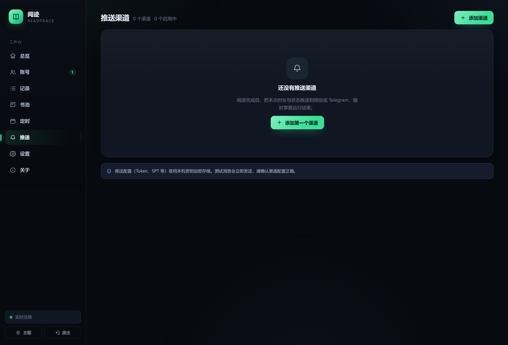

# 阅迹 · ReadTrace

> 每一次阅读，都留下痕迹。

> [!WARNING]
> 本项目与腾讯 / 微信读书官方无关。它通过模拟微信读书网页端的心跳请求保持阅读时长，**可能违反微信读书用户协议并导致账号被限制或封禁**。请仅用于个人学习与自托管研究：
>
> - 不要公开运营、不要提供代刷服务、不要收费或大规模滥用；
> - 多用户部署请自行完成个人信息保护、数据安全与当地法律合规评估；
> - 开源代码不构成对第三方服务的授权，作者不对账号封禁、数据丢失、协议变更或任何法律纠纷负责。

一个单文件、可自托管的微信读书阅读面板。扫码登录，实时看进度，自动跑定时，把阅读时长和数据都留在自己手里。

阅迹把“刷阅读时长”做成一个带可视化面板的常驻服务：**Go 单二进制 + SQLite + 内嵌前端**，打开浏览器就能管理账号、看实时进度、查历史趋势、配推送与定时任务。


---

## 核心亮点

| 能力 | 阅迹 · ReadTrace |
| --- | --- |
| 部署形态 | **单个二进制**，内嵌前端，无需 Node/Python |
| 配置方式 | **可视化面板**，配置存 SQLite |
| 登录方式 | **微信扫码登录**，也支持 curl / Cookie 导入 |
| 运行状态 | **SSE 实时进度 + 日志流**，可随时停止 |
| 历史数据 | **每日时长、连续天数、累计趋势、运行记录** |
| 多账号 | **多账号独立配置与统计** |
| 定时任务 | 面板内 **图形化 cron + 下次执行时间 + 启停** |
| Cookie 维护 | 自动续期，失败时标记失效并提示重扫 |
| 推送 | **13 种**：PushPlus / WxPusher / Telegram / ServerChan / Server酱³ / Bark / Ntfy / Gotify / PushDeer / 飞书 / 企业微信 / 钉钉 / Apprise，面板内配置与测试 |
| 数据安全 | **AES-256-GCM 加密落库**，本机密钥 |
| 移动端 / 暗色 | **响应式 + 明暗主题** |

---

## 功能一览

- **扫码登录**：面板直接向微信读书申请登录二维码，手机微信扫码并确认即可绑定；若手机显示 4 位验证码，填入面板即可，无需抓包。
- **实时阅读面板**：进度环、已读分钟、心跳成功/失败次数、实时日志流，卡片随 SSE 自动更新。
- **历史与趋势**：今日/本周/累计时长、连续阅读天数、最近 14 天柱状图、每次运行的完整日志（失败原因直接写进日志，运行记录一键筛选）。
- **多账号**：每个账号独立设置默认时长、心跳间隔、阅读模式、推送渠道与专属抓包模板；账号表内即可一键绑定推送渠道。
- **书池（阅读的书从哪来）**：「书籍导入」支持**书架一键审查导入**（先勾选再确认）、按**书籍 ID / 书名查询导入**，可选只导免费章节或全本导入（已购/会员）；未购买的书会自动跳过。书池管理按账号归属：排序（顺序书单用）、参与/不参与开关、批量删除、逐章查看（含字数与付费标识），还能对照官方目录一键**清理付费未购章节**。面板**不内置任何书籍或模板**，池为空时无法发起阅读。
- **三种阅读模式**：**顺序书单**（默认·推荐：按书池顺序逐本读完，读完一本自动下一本，读完循环回第一本；进入下一章的节奏按章节字数折算，进度跨次运行衔接）/**随机轮换**（每次心跳从池中随机抽取）/**指定书籍 + 进度推进**（像真实翻页一样推进页面参数）。
- **账号指纹模板**：阅读心跳的设备/会话基底。每个账号可保存自己的抓包模板（curl 一键粘贴，签名自动重算）；未配置的账号回落到设置页的全局指纹模板，两者都不存在时会明确报错。不再内置任何默认书。
- **可视化定时任务**：5 段 cron、常见时间预设、未来 3 次执行预览、启停开关、下次执行倒计时。
- **账号状态检测**：后台按设定间隔自动校验登录态（可关闭），发现失效立即在面板标注，并可通过绑定的推送渠道提醒。临时性错误（如接口偶发 errCode）不会污染账号状态。
- **阅读自动重试**：新账号默认失败自动重试 5 次、间隔 30 秒，可调整；登录已失效的情况不会盲目重试。
- **多种推送**：PushPlus、WxPusher、Telegram（支持代理）、ServerChan、Server酱³、Bark、Ntfy、Gotify、PushDeer、飞书、企业微信、钉钉、Apprise（自建 API 服务桥接数十种服务），支持发送测试消息。
- **自定义推送模板**：阅读成功 / 阅读失败 / 账号失效三类事件可分别自定义标题与内容，支持 `{{account}}`、`{{elapsed}}` 等变量。
- **响应式界面**：桌面侧边栏 / 移动端底部导航，深色与浅色主题，跟随系统。
- **数据本地化**：SQLite 单文件，账号 Cookie 与推送 Token 加密存储；复制数据目录即可迁移。

<table>
  <tr>
    <td></td>
    <td></td>
  </tr>
  <tr>
    <td></td>
    <td></td>
  </tr>
  <tr>
    <td></td>
    <td></td>
  </tr>
  <tr>
    <td></td>
    <td></td>
  </tr>
</table>

---

## 快速开始

### 1. 构建

需要 **Go 1.27+**。

```bash
# Linux / macOS
./build.sh 1.2.0

# Windows PowerShell
.\build.ps1 -Version 1.2.0
```

也可以直接用发布页的二进制，或在项目根目录执行：

```bash
go build -trimpath -ldflags "-s -w -X main.version=1.2.0" -o readtrace ./cmd/readtrace
```

### 2. 启动

```bash
# Windows
.\readtrace.exe

# Linux / macOS
./readtrace
```

默认监听 `http://127.0.0.1:8720` 并自动打开浏览器。首次访问会要求设置管理密码——**这不是微信读书密码**，只用于保护面板。

### 3. 绑定账号

在「账号」页点 **扫码添加**，用手机微信扫一扫并在手机上确认；如果手机显示 4 位验证码，就在面板里填入。或者点 **粘贴 Cookie** 导入浏览器里抓到的 `read` 请求。

> 扫码链路：`GET /api/auth/getLoginUid` → 二维码内容 `https://weread.qq.com/web/confirm?uid=...` → 持续长轮询 `GET /api/auth/getLoginInfo`。扫码后可能返回 `NEED_OTP`（手机显示验证码）或直接返回登录凭据，两条路径都已支持，最终写入 `wr_vid` / `wr_skey`。整个过程在服务端完成，不依赖浏览器插件。


### 4. 开始阅读 / 设置定时

- 在总览页点 **开始阅读**，选择时长即可。
- 在「定时」页新建任务，例如每天 01:00 自动阅读 30 分钟。
- 在「推送」页添加渠道，并在账号设置里选择完成后推送到哪个渠道。

---

## 命令行

| 参数 | 默认值 | 说明 |
| --- | --- | --- |
| `-addr` | `127.0.0.1:8720` | 监听地址。局域网访问用 `0.0.0.0:8720` |
| `-data` | 可执行文件同级的 `data` 目录 | 数据目录，存放 SQLite 与密钥文件；也可用 `READTRACE_DATA` 指定 |
| `-no-open` | `false` | 启动后不自动打开浏览器 |
| `-log-level` | `info` | `debug` / `info` / `warn` / `error` |
| `-retain-days` | `90` | 运行记录（含日志）保留天数，超期自动清理，`0` 表示永久保留 |
| `-host-allow` | 空 | Host 白名单（逗号分隔主机名），为空不校验。绑定 `0.0.0.0` 时建议设置，可防 DNS 重绑定 |
| `-version` | | 输出版本号 |
| `-reset-password` | | 清除面板密码（下次启动重新初始化），账号数据保留 |

对应环境变量：`READTRACE_ADDR`、`READTRACE_DATA`、`READTRACE_LOG_LEVEL`、`READTRACE_RETAIN_DAYS`、`READTRACE_HOST_ALLOW`。旧版的 `WXREAD_*` 仍会自动识别，`wxread.db` 也会在首次启动时重命名为 `readtrace.db`。

示例：

```bash
# 局域网 NAS 上运行
READTRACE_ADDR=0.0.0.0:8720 READTRACE_DATA=/volume1/docker/readtrace ./readtrace -no-open

# 忘记面板密码
./readtrace -reset-password -data ./data
```

---

## 数据与安全

数据目录结构（默认与二进制同目录，例如 `C:\ReadTrace\readtrace.exe` + `C:\ReadTrace\data\`）：

```
readtrace(.exe)
data/
├── readtrace.db      # SQLite：账号、运行记录、日志、定时任务、推送渠道、设置
├── readtrace.db-wal  # SQLite WAL
└── secret.key     # 本地 AES-256-GCM 主密钥（32 字节）
```

- 账号 Cookie 与推送 Token **加密后**写入数据库，密钥文件权限为 `0600`。
- 面板密码使用 **bcrypt（cost 12）** 哈希存储，登录会话写在 SQLite，30 天过期。
- 所有修改类接口要求同源会话 + `X-Requested-With` 头；默认只监听 `127.0.0.1`。
- 迁移：停止服务，把整个 `data/` 目录复制到新机器即可。
- 备份：定期复制 `data/` 目录；**丢失 `secret.key` 后加密数据无法恢复**，需要重新登录账号。
- 保留策略：运行记录及其日志默认保留 **90 天**（`-retain-days` 可调，`0` 为永久），启动时与每日自动清理超期数据。

> 通过公网访问时，请在前面加一层 HTTPS 反向代理（Nginx / Caddy / Traefik），否则管理密码与会话会以明文经过网络。HTTPS 下服务会自动给会话 Cookie 加上 `Secure`。

---

## 部署

### Linux 服务器

二进制放哪个目录，数据就生成在同级 `data/` 目录（例如 `/opt/readtrace/readtrace` + `/opt/readtrace/data`），无需传 `-data`；同一份代码交叉编译即可：

```bash
CGO_ENABLED=0 GOOS=linux GOARCH=amd64 go build -trimpath -ldflags "-s -w -X main.version=1.2.0" -o readtrace ./cmd/readtrace
```

### Windows 开机自启

将 `readtrace.exe` 放入一个固定目录（建议 `C:\ReadTrace`），首次运行后会在同级自动生成 `data` 目录。创建一个快捷方式放到 `shell:startup`：

```
目标： "C:\ReadTrace\readtrace.exe"
起始位置： C:\ReadTrace
```

或者用任务计划程序，触发器设为“登录时”，操作指向 exe，参数 `-no-open`。数据默认就在 exe 同级的 `data` 目录，也可以用 `-data` 显式指定。

### Linux systemd

```ini
[Unit]
Description=ReadTrace
After=network.target

[Service]
Type=simple
User=readtrace
WorkingDirectory=/opt/readtrace
ExecStart=/opt/readtrace/readtrace -addr 127.0.0.1:8720 -data /opt/readtrace/data -no-open
Restart=always
RestartSec=3

[Install]
WantedBy=multi-user.target
```

```bash
sudo systemctl daemon-reload
sudo systemctl enable --now readtrace
```

### Docker

```bash
docker build -t readtrace .
mkdir -p data
docker run -d --name readtrace -p 8720:8720 \
  -v ./data:/opt/readtrace/data readtrace
```

容器内以非 root 用户运行，默认监听 `0.0.0.0`，请务必设置管理密码，并建议只在局域网或反代后暴露。

---

## 工作原理

### 阅读心跳

微信读书网页端阅读时每 30 秒会向 `/web/book/read` 发送一次心跳，上报当前书籍、章节、阅读进度与时间差。每次请求都带两个签名：

- `sg = sha256(ts + rn + KEY)`
- `s = cal_hash("k=v&..." 按 key 排序、URL 编码)`

阅迹用 Go 复刻了同一套签名逻辑（见 `internal/weread/sign.go`），并附带与官方 Python 实现逐字节对照的单元测试。`rt` 直接取自真实流逝时间；心跳间隔带 ±10% 抖动、定时任务触发带 0~90 秒随机延迟，避免固定的节奏指纹。

单次心跳流程：

1. 从账号配置加载请求模板（该账号保存的抓包模板；未配置时用设置页的**全局账号指纹模板**——两者都不内置默认书）。
2. 按阅读模式决定本次心跳读的书与章节：**顺序书单**按书池顺序逐章推进（读满一章的字数预算才切换，读完整本自动下一本并循环）；**随机轮换**从池中随机抽取；**指定书籍**固定一本书并模拟翻页推进。
3. 更新 `ct`、`rt`、`ts`、`rn`，重新计算 `sg` 与 `s`。
4. POST `/web/book/read`，检查 `succ` / `synckey`。
5. 没有 `synckey` 时调用 `/web/book/chapterInfos` 修复；连续失败会停止并提示。
6. 登录态异常时调用 `/web/login/renewal` 自动续期，失败则标记账号失效。

### 实时面板

后端通过 SSE（`/api/events`）推送以下事件：`run.start`、`run.tick`、`run.log`、`run.end`、`schedule.fire`、`schedule.skip`、`schedule.error`。前端用原生 `EventSource` 订阅，进度环、日志流与全局提醒随事件更新。

### 数据统计

统计**不依赖微信读书官方接口**，而是根据本工具每次运行的真实心跳记录聚合：按面板时区切分自然日，计算今日、本周、累计、连续天数与 14 天趋势。因此数据准确、可控，也避免了额外的接口风控。

### 定时任务

使用 `robfig/cron` 解析标准 5 段表达式，时区跟随「设置」中的站点时区。任务触发时如果账号已在阅读，会跳过并记录原因。

### 账号状态检测

后台任务按「设置 → 账号状态检测」配置的间隔自动校验每个账号的登录态（校验逻辑与手动「检查登录状态」一致：先验证，必要时续期一次再复判）。正在阅读的账号会跳过——它们的循环本身就在续期。检测确认失效后会把账号标记为「已失效」，并在该账号绑定了推送渠道时推送一次「账号失效」提醒（`expired` 模板可自定义）。

### 阅读自动重试

每个账号可配置失败自动重试次数与间隔（「账号 → 编辑」）。一次阅读会话（续期 + 心跳循环）失败后，若仍有重试额度且失败属于可重试类型，引擎会在间隔后重新开始会话，已读进度与心跳计数累计保留；登录已确认失效的情况不会自动重试。

---

## 常见问题

### 阅读时长不涨 / 涨得不对

1. 确认**请求模板**可用：在「账号 → 编辑」里按提示保存一份抓包模板（浏览器 F12 → Network → 复制 `read` 请求的 curl），或在**设置页 → 账号指纹模板**配置一份全局模板。面板不内置任何默认书/模板。
2. 阅读模式建议使用**顺序书单**（默认），并把书放入账号的书池；随机轮换需要池里同时存在书籍与章节。
3. 心跳间隔保持 30 秒；过短可能被服务端判定异常。
4. 在「记录」页打开本次运行，日志会带上当前读的《书名》· 章节名与 `synckey`/错误码。

### 扫码后手机显示什么

有两种情况，面板都支持：

- **手机显示「登录成功」**：面板会自动收到凭据并完成绑定；
- **手机显示 4 位验证码**：把验证码填到面板的输入框里提交即可。

如果手机已经显示成功、面板却一直停在「等待微信扫码」，先点「刷新二维码」再扫一次；仍然不行的话，把服务端日志发出来，里面会打印每次轮询返回的 `logic`。

### 二维码长时间无反应

微信读书的扫码会话没有固定倒计时，面板会持续长轮询等待。如果等待超过 2 分钟仍无反应，点「刷新二维码」重新获取即可。

### 登录失效

运行日志会出现 `errCode=-2012/-2013`，面板会尝试自动续期；仍失败时账号状态变为「已失效」，重新扫码即可（同一微信号会更新原账号，不会重复创建）。

### 端口被占用

```bash
./readtrace -addr 127.0.0.1:8721
```

### 忘记面板密码

```bash
./readtrace -reset-password -data ./data
```

然后重新启动，按首次初始化流程设置新密码。账号与历史数据不会丢失。

### 多账号会互相影响吗

不会。每个账号有独立的 Cookie、模板、设置、运行记录与统计；定时任务也按账号独立执行。

### 会被封号吗

本工具通过模拟阅读心跳保持时长，**可能违反微信读书用户协议并触发风控**。请自行评估风险，仅用于个人学习与自动化研究，不要用于商业用途或大规模滥用。

---

## 开发

```bash
# 运行测试
go test ./...

# 静态检查
go vet ./...

# 开发模式（前端是内嵌静态资源，改完 JS/CSS 需要重新 build）
go run ./cmd/readtrace -addr 127.0.0.1:8720 -data ./data
```

目录结构：

```
cmd/readtrace/      入口：参数、启动、优雅退出
internal/api/          HTTP API、认证、SSE、扫码流程
internal/checker/      后台账号状态自动检测
internal/engine/       阅读心跳引擎、事件中心
internal/sched/        cron 调度
internal/notify/       推送渠道与消息模板
internal/store/        SQLite 数据层与迁移
internal/secure/       AES-GCM 加密
internal/weread/       微信读书客户端、签名、curl 解析
internal/webui/assets/ 内嵌前端（原生 ES Module，无构建步骤）
docs/screenshots/      README 截图
```

前端刻意不使用打包器：`go:embed` 直接嵌入原生 ES Module、CSS 与 SVG 图标，改样式不需要 Node 工具链，保证“单二进制”这一目标。

---

## 免责声明

- 本项目与腾讯 / 微信读书官方无关。
- 微信读书接口可能随时变化，本项目不保证长期可用。
- 使用本工具产生的任何账号风险、数据丢失或协议纠纷，由使用者自行承担。
- 请遵守相关服务条款，仅将本项目用于个人学习与技术研究。

## License

本项目以 [AGPL-3.0](LICENSE) 协议开源。

- 以 AGPL-3.0 发布意味着：任何人都可以自由使用、修改与再分发本项目，但**修改版的源码必须以相同协议开放**。
- 如果将本项目（或其修改版）作为**网络服务**运行，必须向使用该服务的用户提供对应修改版的源代码（AGPL-3.0 第 13 条）。把面板包壳后闭源运营、或以修改版对外提供代刷服务而不开放源码，均违反本协议。
- 协议约束的是代码与衍生品；README「免责声明」中对微信读书用户协议与使用方式的提示仍然适用，与开源协议互不替代。
